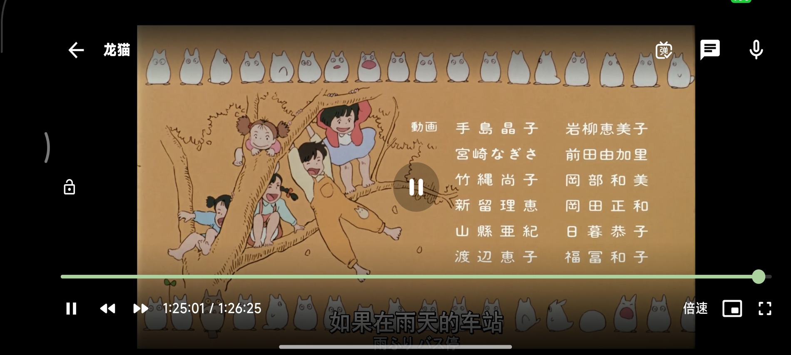
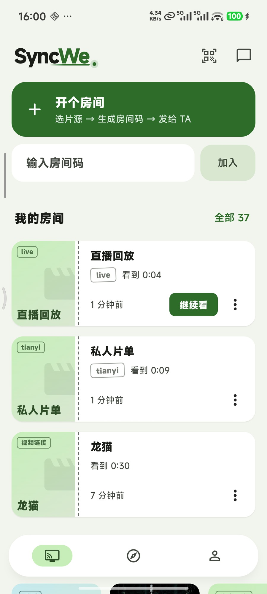
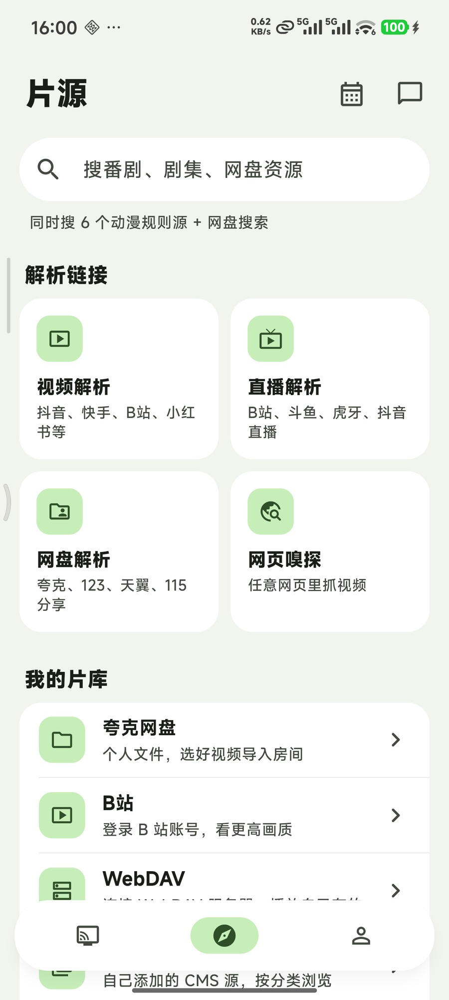
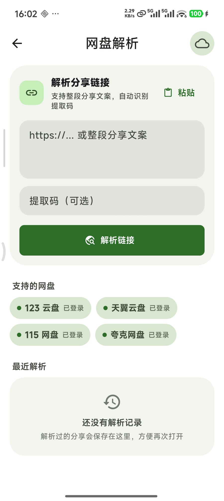
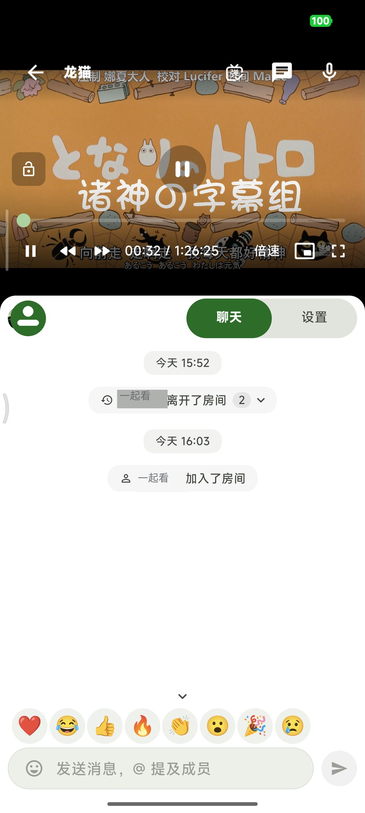

  

<h1 align="center">SyncWe</h1>

  和朋友、家人、另一半同步看同一个视频——进度一致，边看边聊。

  
  
  
  

  <a href="https://github.com/SyncweApp/syncwe/releases/latest"><b>下载应用</b></a>
  &nbsp;&nbsp;·&nbsp;&nbsp;
  <a href="https://syncwe.top/">官网</a>
  &nbsp;&nbsp;·&nbsp;&nbsp;
  <a href="docs/guide/getting-started.md">新手入门</a>
  &nbsp;&nbsp;·&nbsp;&nbsp;
  <a href="docs/help.md">常见问题</a>
  &nbsp;&nbsp;·&nbsp;&nbsp;
  <a href="https://github.com/SyncweApp/syncwe/issues">反馈</a>

---

## 同步观看，边看边聊

|  |  |
|---|---|
| **🎯 秒级同步** 播放、暂停、拖动进度实时对齐，所有人看到同一帧。 | **🌍 全平台** Android · iOS · macOS · Windows，一个房间跨设备同看。 |
| **🎬 多源播放** 123 / 天翼 / 115 / 夸克网盘、WebDAV / Alist、Emby，50+ 平台视频解析。 | **💬 边看边聊** 聊天、弹幕、语音通话，还能 @ 房间 Bot。 |

---

## 截图

<table>
  <tr>
    <td width="50%"></td>
    <td width="50%"></td>
  </tr>
  <tr>
    <td align="center">一起看 · 开房与房间列表</td>
    <td align="center">片源 · 粘贴链接与片库</td>
  </tr>
</table>

### 📱 手机端截图

<table>
  <tr>
    <td width="25%"></td>
    <td width="25%"></td>
    <td width="25%"></td>
    <td width="25%"></td>
  </tr>
  <tr>
    <td align="center">新版首页</td>
    <td align="center">片源</td>
    <td align="center">网盘解析</td>
    <td align="center">房间播放</td>
  </tr>
</table>

---

## 功能

### 🎥 房间与互动

- 同步播放、暂停、拖动进度，所有人看到同一帧
- 房间码邀请，公开或私密房间、人数上限
- 聊天、弹幕、语音通话，还能 @ 房间 Bot
- 播放列表，看完一集自动接下一集

### 🏠 新版首页

- 「房间 / 片源 / 我的」三栏结构，找片、开房、管理账号更直接
- 房间列表改成票券卡片，状态、集数和进度一眼可见
- 设置里可以随时切回旧版首页

### 📺 片源与解析

- 123 云盘、天翼云盘、115 网盘、夸克网盘、WebDAV / Alist、Emby 媒体服务器
- 115 / 夸克支持 App 内扫码登录，不用手动抓 Cookie
- 粘贴分享链接或整段分享文案即可解析，自动识别提取码，解析页保留最近记录
- 视频解析：粘贴抖音、快手、小红书等 50 个平台分享链接即可播放
- 直播解析（抖音 / 哔哩哔哩）、网页视频嗅探
- 网盘搜索、基于 XPath 社区规则的动漫搜索、番剧排期

### 🎮 播放器

- 原生 / MPV / MDK 三种内核可切换
- 倍速、字幕、音轨切换
- 画中画、DLNA 投屏

### 💾 个人中心

- 观影档案，记录一起看过的片子
- 观看历史：房间、网盘、动漫、Emby 统一聚合，支持续播和批量删除
- 私聊、影评、用户排行

---

## 指南

| 从这里开始 | 接入片源 | 更多工具 |
|---|---|---|
| [新手入门](docs/guide/getting-started.md) | [夸克网盘](docs/guide/quark_netdisk.md) | [视频解析](docs/guide/video_analyse.md) |
| [常见问题](docs/help.md) | [WebDAV / Alist](docs/guide/webdav_alist.md) | [视频嗅探](docs/guide/video_sniffer.md) |
| | [Emby](docs/guide/emby_guide.md) | [直播解析](docs/guide/live_parser.md) |
| | [动漫搜索](docs/guide/anime_search.md) | |

---

## 下载

| 平台 | 安装包 | 系统要求 |
|---|---|---|
| 🤖 **Android** | `.apk`：arm64-v8a / armeabi-v7a / x86_64 | Android 7.0+ |
| 🍎 **iOS** | `.ipa`，用 AltStore / Sideloadly 自签安装 | iOS 15.4+ |
| 💻 **macOS** | `.dmg` | macOS 12.0+ |
| 🪟 **Windows** | `windows_x64_setup.exe` | Windows 10+（x64） |

> 大多数手机选 **arm64-v8a**。安装包见 [GitHub Releases](https://github.com/SyncweApp/syncwe/releases/latest)，其他下载方式见 [官网下载页](https://syncwe.top/download/)。

---

## 社区

**反馈 & 交流** — 问题和建议 → [GitHub Issues](https://github.com/SyncweApp/syncwe/issues) · 更新动态 → [WhatsApp 频道](https://whatsapp.com/channel/0029Vb7ZAfYEwEk27mbDW71Q)

**贡献规则** — 动漫搜索规则由社区维护，欢迎到 [SyncweRules](https://github.com/SyncweApp/SyncweRules) 提交新规则或修复失效规则。

### ⭐ Star History

---

  Syncwe 只是一个播放和同步工具，本身不提供任何视频内容。视频均来自第三方网站或用户自己的资源，请遵守当地法律法规使用。  
  使用即表示同意 <a href="docs/terms.md">用户协议</a> 和 <a href="docs/privacy.md">隐私政策</a>  
  Copyright © 2025–2026 Syncwe &nbsp;·&nbsp; <a href="#top">回到顶部 ↑</a>

